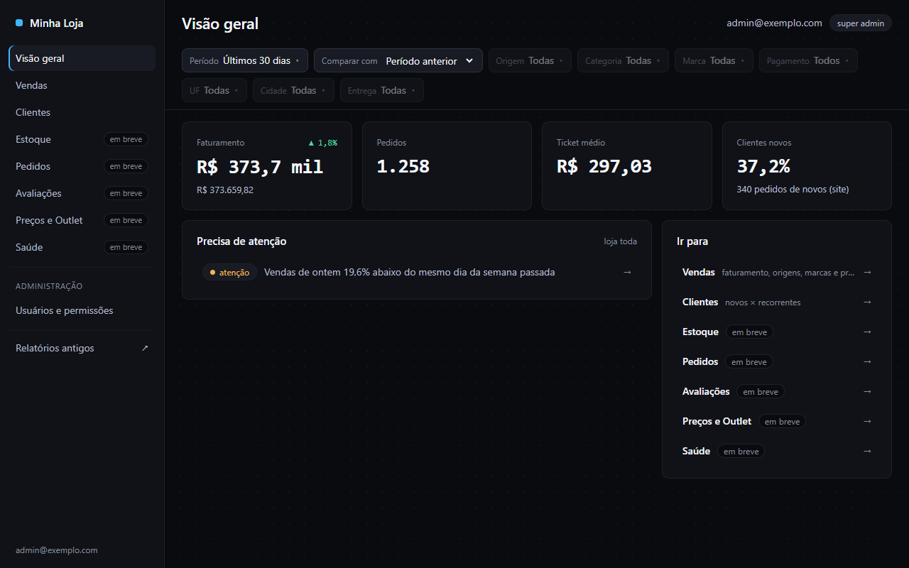
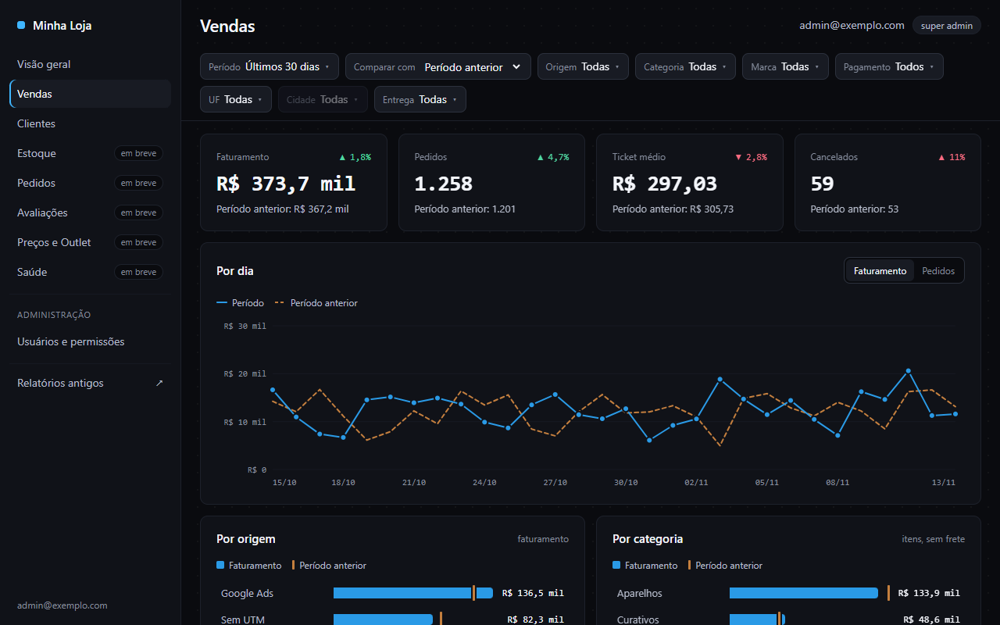
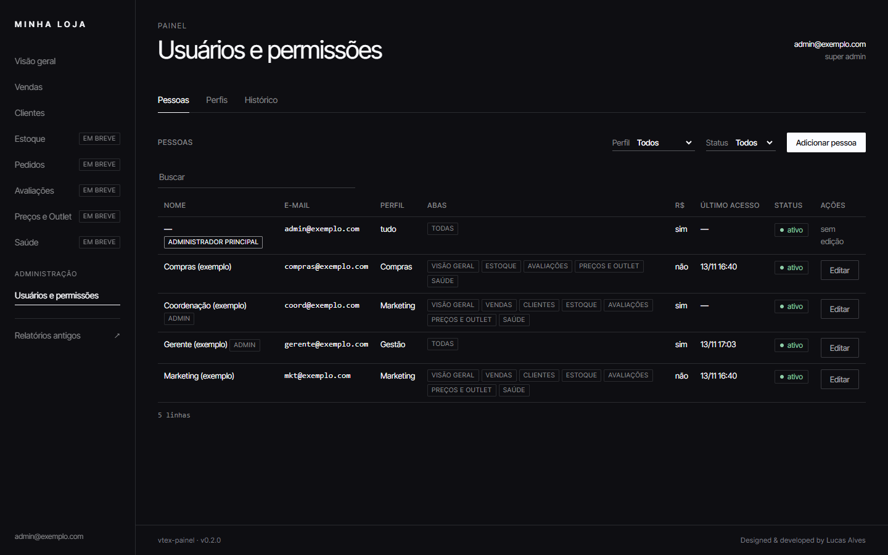

# vtex-painel

Painel de vendas e clientes para lojas VTEX. Roda em Cloudflare Pages + Functions + D1, sem build (HTML/CSS/JS puros) e com coletor em Node 22.

## O que é

- Visão geral, vendas e clientes (novos x recorrentes) a partir dos pedidos da VTEX
- Filtros por período, origem, categoria, marca, pagamento, UF, cidade e entrega
- Login pelo Cloudflare Access, permissões por pessoa e por aba
- Aviso quando a coleta de dados está atrasada
- Abas "estoque", "pedidos", "avaliações", "preços" e "saúde" já existem no menu (marcadas "em breve")

## Prints

Dados fictícios gerados por `scripts/semear-local.mjs`.







## Arquitetura

```
 VTEX (OMS)                      Cloudflare
 ┌────────┐   coletor (Node)   ┌─────────────────────────────┐
 │ pedidos│ ─────────────────► │ D1 (SQLite)                 │
 └────────┘  cron / manual     │   pedidos, usuarios, perfis │
                               │          ▲                  │
 Navegador ── Access (login) ─►│ Pages ── Functions /api/*   │
 (public/ HTML+JS)             └─────────────────────────────┘
```

- `public/`: o painel (front-end estático)
- `functions/`: API (`/api/*`) e regras de permissão
- `coletores/`: lê pedidos da VTEX e grava no D1
- `migrations/`: esquema do banco e perfis padrão

## Requisitos

- Conta Cloudflare (Pages, D1 e Access/Zero Trust)
- Node 22.5 ou superior
- Loja VTEX com uma chave de API (appKey/appToken) que leia pedidos (OMS)

## Instalação

1. Clone e instale:
   ```bash
   git clone <url-do-repositorio> vtex-painel && cd vtex-painel
   npm ci
   ```
2. Crie o banco D1 e anote o `database_id`:
   ```bash
   npx wrangler d1 create painel
   ```
3. Crie o `wrangler.toml` a partir do exemplo e preencha o `database_id` e as variáveis (tabela abaixo):
   ```bash
   cp wrangler.exemplo.toml wrangler.toml
   ```
4. Crie o `config.json` a partir do exemplo (nome da loja, fuso, origens, afiliados, abas):
   ```bash
   cp config.exemplo.json config.json
   ```
5. Aplique as migrações no banco remoto:
   ```bash
   npx wrangler d1 migrations apply painel --remote
   ```
6. Crie um token de API da Cloudflare com permissão de editar o D1 e rode a primeira coleta (13 meses de histórico):
   ```bash
   export VTEX_CONTA=minhaloja VTEX_APP_KEY=... VTEX_APP_TOKEN=...
   export CF_ACCOUNT_ID=... CF_D1_ID=<database_id> CF_API_TOKEN=...
   node coletores/coletar-pedidos.mjs --config config.json --meses 13
   ```
   A carga para sozinha no limite de tempo (padrão 300 min) e continua de onde parou na próxima execução com `--meses`.
7. Publique o painel:
   ```bash
   npx wrangler pages project create minhaloja-painel --production-branch main
   npx wrangler pages deploy public --project-name minhaloja-painel
   ```
8. Proteja com Cloudflare Access: crie uma aplicação (Zero Trust > Access > Applications) para o domínio do Pages, copie o **Application Audience (AUD)** e o nome da equipe para `ACCESS_AUD` e `ACCESS_TEAM`, e publique de novo.
9. Agende a coleta diária (cron do seu servidor, GitHub Actions ou similar):
   ```bash
   node coletores/coletar-pedidos.mjs --config config.json --dias 15
   ```

### Variáveis das Functions (`wrangler.toml` > `[vars]`)

| Variável | Para quê |
|---|---|
| `SUPER_ADMIN` | e-mail do administrador principal (vê tudo, não depende de cadastro) |
| `ACCESS_TEAM` | nome da equipe no Cloudflare Access |
| `ACCESS_AUD` | AUD da aplicação no Access |
| `LOJA_NOME` | nome exibido no topo |
| `FUSO_HORAS` | fuso da loja em horas, ex.: `-3` |
| `AGENDA_JSON` | atraso máximo por fonte antes do aviso, ex.: `{"pedidos":{"horasMax":3}}` |
| `DOMINIO_PERMITIDO` | opcional: só aceita cadastrar e-mails desse domínio |
| `DEV_EMAIL` | só desenvolvimento local (ver abaixo); não use em produção |

### Variáveis do coletor (ambiente, nunca no Cloudflare)

| Variável | Para quê |
|---|---|
| `VTEX_CONTA` | nome da conta VTEX (`minhaloja`) |
| `VTEX_APP_KEY` / `VTEX_APP_TOKEN` | credenciais da VTEX; ficam só no ambiente do coletor |
| `CF_ACCOUNT_ID` | ID da conta Cloudflare |
| `CF_D1_ID` | `database_id` do D1 |
| `CF_API_TOKEN` | token com permissão de editar o D1 |

Opções do coletor:

| Opção | Para quê |
|---|---|
| `--config <arquivo>` | obrigatória |
| `--dias N` | janela dos últimos N dias, sempre relida (padrão 15) |
| `--meses N` | também carrega o histórico: os N meses anteriores ao atual e os dias do mês corrente antes da janela |
| `--limite-minutos N` | tempo máximo da execução (padrão 300); a carga para entre dois dias ao passar dele |

Como a coleta anda:

- A janela roda primeiro e a carga usa o tempo que sobrar. Uma falha numa não impede a outra.
- Cada dia da carga gravado sem erro fica marcado (`carga:AAAA-MM-DD` na tabela `coletas`); um mês interrompido retoma do próximo dia que falta. O mês inteiro sem erro vira `carga:AAAA-MM` e não é refeito.
- `coletas` guarda a última tentativa (`quando`, `ok`, `erro`) e a última coleta boa (`ultimo_ok`, migração `0003`). Uma falha não apaga o "dados até": o topo avisa "Última coleta falhou às X; dados até Y".
- Os valores da barra de filtros (origens, marcas, cidades…) ficam prontos na tabela `opcoes` (migração `0004`), com o último dia em que cada um apareceu. O coletor atualiza só os dias que acabou de gravar, e a barra lê poucas mil linhas em vez de varrer o histórico a cada abertura. Um valor que deixou de existir nos pedidos sai da barra quando passa de 400 dias sem aparecer.
- O coletor usa o wrangler fixado no `package.json` (`node_modules` do produto, mesmo rodando de outra pasta) e repete até 3 vezes quando ele falha (5 s, 15 s, 45 s). Rode `npm ci` na pasta do produto antes.
- Quem roda o coletor de outra pasta (ex.: o produto em `produto/`) aponta o `--config` para o arquivo da instância normalmente; só o wrangler vem do produto.

Arquivos com segredos ou dados da loja (`config.json`, `wrangler.toml`, `.dev.vars`) estão no `.gitignore`.

## Atualizando

Aplique as migrações novas **antes** de rodar o coletor da versão nova (o coletor grava colunas que elas criam):

```bash
npx wrangler d1 migrations apply painel --remote
```

Depois publique o `public/` de novo.

## Permissões

- **Perfis padrão** (migração `0002`): Gestão, Marketing, Compras e Atendimento, cada um com um conjunto de abas e a opção de ver valores em R$
- **Ajustes por pessoa**: para cada aba, `herdado` (segue o perfil), `liberado` ou `bloqueado`; também "ver R$" e "admin"
- **Super admin**: definido por `SUPER_ADMIN`; sempre vê tudo e não pode ser editado pelo painel
- **Admin comum**: gerencia pessoas, mas não edita o próprio registro (exceto o nome) nem outros admins
- **Perfis**: só o super admin cria ou edita
- Quem entra pelo Access mas não está cadastrado vê a tela "sem acesso"
- Toda alteração fica no histórico (aba Usuários e permissões > Histórico)

## Desenvolvimento local

```bash
cp wrangler.exemplo.toml wrangler.toml
printf 'DEV_EMAIL=admin@exemplo.com\nSUPER_ADMIN=admin@exemplo.com\n' > .dev.vars
npm run db:migrar     # cria o banco local
npm run semear        # 90 dias de pedidos fictícios
npm run dev           # http://localhost:8788
npm test              # testes (node:test)
```

- `DEV_EMAIL` só vale em `localhost` e dispensa o Access
- Os dados semeados são fictícios e determinísticos

## Licença

MIT. Veja [LICENSE](LICENSE).
